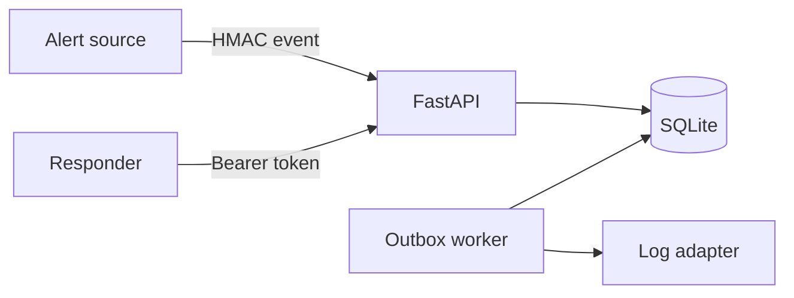

# RelayOps

Incident intake for alerts that arrive more than once. The service deduplicates events, groups a storm into one open incident, and records a notification intent in the same transaction as the incident.

**Status:** portfolio project. One host, SQLite, a log-only delivery adapter. Not a production on-call platform.

## Problem

External monitors retry. Two responders edit the same incident. A notification sent inside the request is lost when the process dies after the response, or sent when the transaction rolls back.

## Design



- **Duplicates.** `external_id` is unique per tenant. A replay returns the original event and does not open a second notification.
- **Storms.** The same service and fingerprint attach to the unresolved incident. A partial unique index allows a new incident after resolve.
- **Tenancy.** API tokens are stored as SHA-256 hashes and carry `viewer`, `responder`, or `admin`. Queries constrain on `tenant_id`. Webhooks use a per-tenant HMAC secret, compared in constant time. Bodies over 64 KiB are rejected before the signature check.
- **Conflicts.** Acknowledge and resolve require the current version. A stale write returns 409. The transition and its outbox row commit together.
- **Delivery.** The worker leases a due row for 30 seconds, retries with capped backoff, and marks the message `dead` after five failures. `POST /v1/outbox/{id}/requeue` (admin) puts a dead message back to `pending` with attempts reset. The adapter logs the payload. A real receiver should dedupe on the outbox id.

## Run

Python 3.11 or newer.

```bash
python -m venv .venv
source .venv/bin/activate
pip install -e '.[dev]'
python -m relayops.cli bootstrap --tenant demo
uvicorn relayops.app:app --reload
```

The bootstrap command prints an admin token and webhook secret once. In another terminal, `python -m relayops.cli worker`. Interactive docs: `http://127.0.0.1:8000/docs`.

`docker compose up --build`, then `docker compose run --rm api python -m relayops.cli bootstrap --tenant demo`.

Sign the raw JSON body with HMAC-SHA256 and send `X-Relay-Signature: sha256=<hex>` to `POST /v1/services/{service_id}/events`. Fields: `external_id`, `fingerprint`, `title`, `severity` (`low`, `medium`, `high`, `critical`). Move an incident with `acknowledge` then `resolve`, body `{"version":1}`.

## Tests

`pytest -q` covers rejected signatures, idempotency, grouping, tenant isolation, roles, optimistic concurrency, the 64 KiB cap, outbox retry, dead-letter, and requeue. CI runs that suite.

## Limits

At-least-once delivery: a crash after the adapter runs and before `delivered` is written can send twice. Dead messages stay dead until an admin requeues them. SQLite and the log adapter are the scope, not a stepping stone that is already implied. More than one API or worker process needs PostgreSQL, a real lease, row-level security, and a receiver that dedupes. Tokens and the database file must not be committed. Assume TLS at a reverse proxy.

## Decisions

- [ADR 001 Transactional outbox](docs/adr-001-transactional-outbox.md)
- [ADR 002 Tenant boundaries](docs/adr-002-tenant-boundaries.md)
- [ADR 003 SQLite boundary](docs/adr-003-sqlite-boundary.md)
