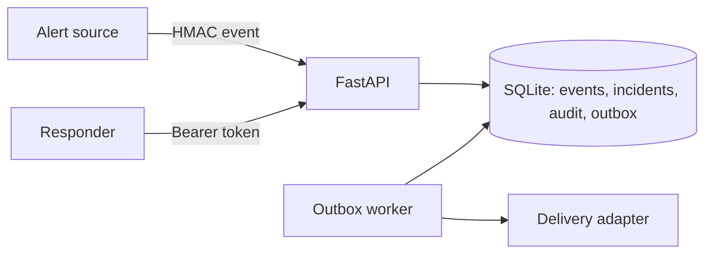

# RelayOps

RelayOps is an incident intake service for teams that receive repeated alerts from external systems. It accepts signed events, groups related events into incidents, records decisions in an audit trail, and delivers notification intents through a transactional outbox.

**Status:** portfolio project. It has automated integration tests and a local container setup. It has not been deployed for real customers or measured under production load.

## Engineering problems demonstrated

- **Duplicate delivery:** `external_id` is unique per tenant. Replayed events return the original event ID without creating a second incident or notification.
- **Alert storms:** events with the same service and fingerprint attach to one unresolved incident. A resolved incident allows a new occurrence.
- **Lost notifications:** incident creation and an outbox row commit together. A worker retries failed delivery and moves a message to `dead` after five failed attempts.
- **Concurrent responders:** acknowledge and resolve require the incident version. Stale updates return HTTP 409.
- **Tenant isolation:** token roles and tenant predicates protect reads and writes. Incoming webhooks use a per-tenant HMAC secret.



The included delivery adapter writes structured log entries so the system can run without an external service. A real integration should use an idempotent downstream API keyed by the outbox message ID.

## Local run

Requires Python 3.11 or later.

```bash
python -m venv .venv
source .venv/bin/activate
pip install -e '.[dev]'
python -m relayops.cli bootstrap --tenant demo
uvicorn relayops.app:app --reload
```

Save the bootstrap output securely. It prints an admin token and webhook secret once. In a second terminal run `python -m relayops.cli worker`. API documentation is available at `http://127.0.0.1:8000/docs`.

Container run: `docker compose up --build`. Bootstrap the tenant with `docker compose run --rm api python -m relayops.cli bootstrap --tenant demo`.

## Example flow

Create a service:

```bash
curl -X POST http://127.0.0.1:8000/v1/services \
  -H "Authorization: Bearer $ADMIN_TOKEN" -H 'Content-Type: application/json' \
  -d '{"name":"Payments"}'
```

Send an alert to `/v1/services/{service_id}/events`. Sign the exact JSON bytes with `HMAC-SHA256` using `WEBHOOK_SECRET`, then set `X-Relay-Signature: sha256=<hex>`. The body must contain `external_id`, `fingerprint`, `title` and `severity` (`low`, `medium`, `high`, or `critical`). The response contains the event and incident IDs. List incidents with `GET /v1/incidents` and move an incident through `acknowledge` then `resolve`, passing its current version in `{"version":1}`.

## Tests

`pytest -q` covers HMAC rejection, idempotency, grouping, tenant isolation, role enforcement, optimistic concurrency, and outbox retry. CI runs the suite on each push and pull request.

## Security and operations

API tokens are stored as SHA-256 hashes. Webhook signatures use constant-time comparison. Request bodies are capped at 64 KiB. This example assumes TLS termination at a trusted reverse proxy for network deployment. Logs should not contain credentials. Never commit `.env` or the SQLite database.

The outbox worker has a 30-second processing lease. If delivery succeeds and the worker crashes before writing `delivered`, a message can be delivered twice. A production notification provider would need idempotency or receiver-side deduplication. Dead messages need an operator requeue workflow; that is not implemented yet.

SQLite keeps the project easy to run and inspect. The single-host database and log-only delivery adapter are deliberate scope limits, not a claim of production readiness. Scaling to multiple API and worker hosts would require PostgreSQL, tenant row-level security, tracing, external delivery integration, and load testing.

## Decisions and roadmap

- [ADR 001 Transactional outbox](docs/adr-001-transactional-outbox.md)
- [ADR 002 Tenant boundaries](docs/adr-002-tenant-boundaries.md)
- Next: notification destination configuration, dead-message replay, metrics, and load tests.
